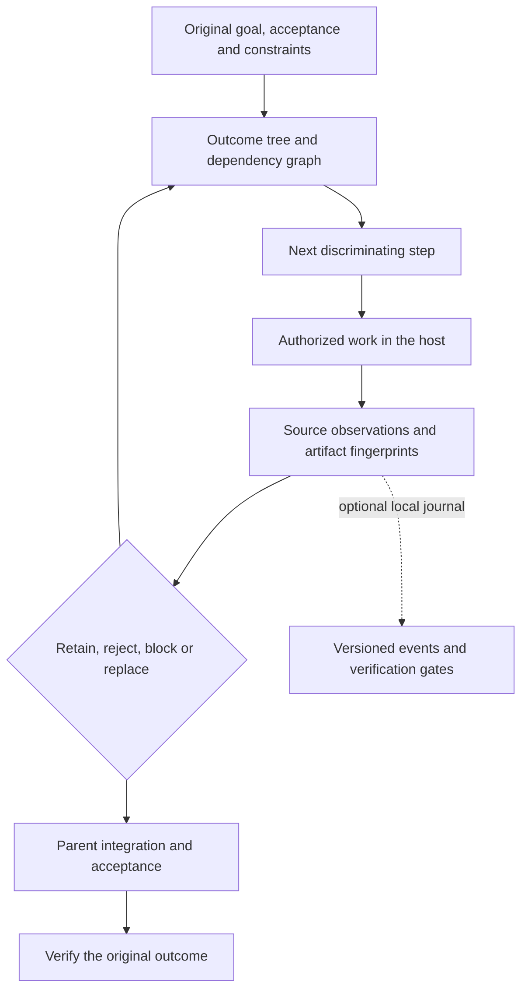

# Recursive Outcome Delivery for Codex

**Deliver complex goals through evidence and explicit acceptance checks.**

Recursive Outcome Delivery combines a Codex skill with an optional Python evidence ledger for work that spans dependencies, experiments and revisions.

The central design decision is to separate **doing work**, **recording evidence** and **accepting the outcome**. A migration, for example, needs a data check in the intended destination; successful export and import commands are intermediate results.

## Architecture



The [skill](skills/outcome-decomposition/SKILL.md) guides planning, execution and replanning. The [state tool](skills/outcome-decomposition/references/state-tool.md) records the outcome graph and checks its declared evidence gates.

| Mechanism | Implemented behavior |
|---|---|
| Outcome tree + dependency graph | Required children and prerequisites must be verified before a parent can close. The root also needs its own evidence. |
| Evidence tied to acceptance | Each criterion needs supporting evidence. Contradictions need an explicit resolution based on later supporting evidence. |
| Artifact fingerprints | Optional SHA-256 captures make later file changes visible during verification. |
| Replacement-aware invalidation | Revisions invalidate affected descendants, dependent outcomes and parent integration proof, including dependencies redirected through replacement chains. |
| Persistent decisions | Explicit block/reject decisions survive automatic proof invalidation; resuming requires a deliberate revision or replacement. |
| Replayable task journals | Hash-chained events preserve the original objective, criteria, constraints and history. Schema 1 journals require an explicit upgrade and fresh verification. |

## Published package and maintainer's unreleased workflow

The **published package** on `main` has plugin version **2.0.0** and journal schema **2**. Its install commands below provide the Codex skill and `odrd.py` described above. The journal's schema 2 migration and invalidation rules are part of this public package.

The maintainer also runs an **unreleased local workflow** (`2.1.0-codex`) that extends this method. It is not part of this repository, and its code is not published here.

| Capability | In this package (2.0.0) | Unreleased local workflow (not installable from here) |
|---|---|---|
| **T0–T3 execution topology** | Adaptive decomposition and direct handling of simple leaves in the skill. | Named modes from solo work through parallel worker waves and milestone dependency graphs. |
| **8-Gate acceptance** | Criterion-level evidence, dependency and parent-integration checks in the journal. | A separate G1–G8 research acceptance checklist, used with companion research and preflight skills. |
| **Agentic Variation Operator (AVO)** | Discriminating experiments, scoring and recorded replanning. | Additional variation-lineage tooling for measurable optimization, correctness checks and noise-aware comparisons. |
| **Epistemic preflight** | Provenance and revision relationships recorded in evidence entries. | Companion checks for observation/inference labels, coverage, arithmetic and report structure. |
| **Single-writer work ownership** | Cooperative local journal locking and atomic replacement. | Explicit ownership of files or modules for each parallel worker; this is a work-allocation rule. |
| **`DEAD_ENDS.md`** | Rejected approaches and revisions can be retained in the journal. | An append-only record of rejected approaches for later waves. |

Installing the plugin adds nothing from the right-hand column: no T0–T3 wave instructions, G1–G8 checklist, preflight engine or AVO scripts.

## Install

Use a Codex host with plugin support. Python 3.10+ is required only for the optional local state tool; it uses the standard library. The [host validation record](docs/validation.md) covers installation and skill discovery for 1.0.x (Codex CLI 0.159.2 and the Desktop app-server). The unit suite and the [schema 2 record](docs/state-v2-2026-10-02.md) cover the 2.0.0 state-tool changes.

```sh
codex plugin marketplace add trukhinyuri/outcome-driven-recursive-decomposition --ref main
codex plugin add outcome-driven-recursive-decomposition@recursive-outcome-delivery
codex plugin list --json
```

For local development:

```sh
codex plugin marketplace add /absolute/path/to/outcome-driven-recursive-decomposition
codex plugin add outcome-driven-recursive-decomposition@recursive-outcome-delivery
```

Refresh skills or start the next chat after installation. Some Desktop versions need an app restart to refresh discovery; avoid interrupting active work for this. Use the host's installation UI when CLI installation is unavailable. The portable manifest, Codex compatibility manifest and repository marketplace catalog carry the same plugin identity.

## Use

```text
Use $outcome-decomposition to migrate this system and prove the result in the destination.
```

The host may expose the namespaced skill as `outcome-driven-recursive-decomposition:outcome-decomposition`. It is eligible for implicit selection for complex planning and execution, including follow-ups that approve or continue a plan. `allow_implicit_invocation: true` enables that eligibility; the host and model select the skill.

- **Plan only:** inspect the relevant sources, define outcomes, dependencies and acceptance checks, then present the plan.
- **Approved plan:** continue the accepted scope through implementation, integration and verification. Partial approval covers only the accepted part.
- **Direct build or fix request:** apply the method during authorized work without adding a separate planning approval gate.
- **Simple task:** execute and check the leaf directly. A tree and journal are optional.

The workflow preserves the original goal across corrections and interruptions. Each experiment has a discriminating result, a resource limit and a decision rule. A failed test can reject an approach; it does not silently replace the user's objective with an easier one.

## Optional task journal

Use the ledger when work needs durable state across branches or interruptions. Locate `scripts/odrd.py` relative to the skill's `SKILL.md`, inspect it, and choose a task file outside the public plugin checkout. The parent directory must exist; use a physical path without symlink components.

```sh
ODRD_TOOL=/absolute/path/to/skills/outcome-decomposition/scripts/odrd.py
mkdir -p /absolute/project/.odrd
python3 "$ODRD_TOOL" init /absolute/project/.odrd/mission.json \
  --goal 'Customers are migrated and served correctly' \
  --criterion 'Destination readback matches the source data' \
  --criterion 'Serving reads pass the agreed acceptance test' \
  --constraint 'No cutover without authorization'

python3 "$ODRD_TOOL" status /absolute/project/.odrd/mission.json
python3 "$ODRD_TOOL" next /absolute/project/.odrd/mission.json --summary
python3 "$ODRD_TOOL" validate /absolute/project/.odrd/mission.json
```

The [state-tool reference](skills/outcome-decomposition/references/state-tool.md) covers `add`, `evidence`, `decide`, `resolve`, `revise`, `replan` and `upgrade`, including their required flags. `next` ranks eligible nodes using an ordinal risk × information / cost heuristic. The agent still chooses work according to dependencies, deadlines and authorization.

Journal schema 2 (plugin 2.0.0) corrects stale evidence after branch replacement. [The migration guide](skills/outcome-decomposition/references/state-tool.md#upgrade-version-1-journals) explains how to preserve a version 1 journal, append the upgrade event and record fresh proof. [The schema 2 verification record](docs/state-v2-2026-10-02.md) documents the defect and regression checks.

## Verification

```sh
python3 -m unittest discover -s tests -v
```

The test suite exercises CLI behavior: parent acceptance, dependency cycles, contradictions, artifact changes, replacement chains, legacy upgrades, explicit controls and cooperative concurrent writers. CI runs it on Python 3.10 and 3.14.

Optional installed-host discovery:

```sh
python3 tools/host_check.py --cwd /path/to/project
```

This starts the local Codex app-server and reads plugin/skill discovery without creating a model turn. Live model evaluations are opt-in; see [the smoke protocol](evals/live-smoke.md), [evaluation cases](evals/cases.json) and [validation record](docs/validation.md). The [screening record](docs/screening-2026-10-01.md) and [comparator contracts](docs/frontier-comparators-2026-10-01.md) retain the historical candidate choices and evaluation gaps.

## Architecture & Operational Boundaries

- **Execution authority stays with the user and host.** The skill supplies a method; the ledger never executes tasks, browses evidence sources or approves external actions.
- **Recorded proof still needs judgment.** The tool checks graph, revision and evidence relationships. It cannot establish whether an entered observation is truthful or an acceptance criterion serves the user's real goal. `validate` checks journal/artifact integrity; exit 0 alone is not mission completion.
- **The journal is local.** A cooperative file lock and atomic replacement protect ordinary local updates. Hash chaining detects ordinary corruption, but someone who can rewrite the journal can also recompute its hashes. This is not a distributed coordination or security boundary.
- **Published integration targets Codex.** Host validation covers 1.0.x on Codex CLI 0.159.2 and the Desktop app-server. Skill discovery and activation can vary by host version and prompt.
- **The package installs no background service.** It contains no MCP server, scheduler, telemetry endpoint, credential reader or global instruction file. It does not change model defaults or authentication. Keep private observations and artifacts outside public repositories.
- **Evidence is scoped.** Tests establish recorded invariants; live smoke runs establish their observed cases. The published evaluations do not establish general superiority over other workflows.

The [engineering basis](skills/outcome-decomposition/references/method.md) connects the workflow to NASA systems engineering, DARPA's research framing, ADaPT and Reflexion, with the role and limits of each source stated explicitly.

## Removal

```sh
codex plugin remove outcome-driven-recursive-decomposition@recursive-outcome-delivery
codex plugin marketplace remove recursive-outcome-delivery
```

Removing the plugin leaves your task journals in place.

## Author and license

Created by [Yuri Trukhin](https://trukhin.com). [MIT license](LICENSE), copyright © 2026 trukhinyuri. Retain the license notice when redistributing the software or substantial portions of it.
